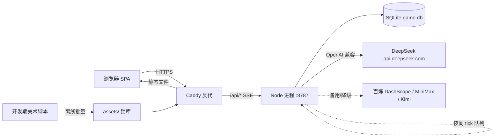
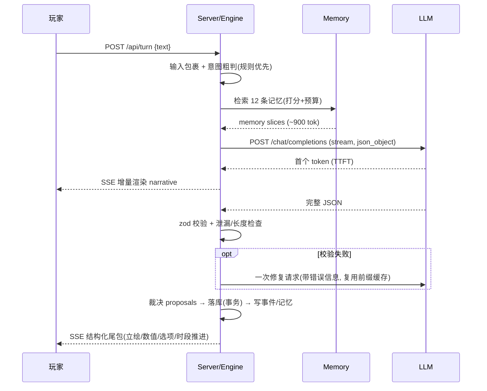

# 校园 AI 游戏 · 开发方案 v1.0

| 项 | 内容 |
|---|---|
| 版本 | v1.0（2026-11-14） |
| 依据 | ① 手绘架构草图（用户/服务器世界/API LLM 三节点 + 数据分类 + 模块 in/out + 供应商清单）②《DeepseekHarness - 校园AI游戏核心引擎开发要求》v1.0（DeepSeek 网页版产出） |
| 目标读者 | 作者本人（独立开发）/ 未来协作者 |
| 定位 | 不是"LLM 聊天壳"，是**引擎裁决 + LLM 表现**的 LLM-Native 文字冒险游戏 |
| 状态 | 方案定稿，可据此直接开工 M0 |

---

## 0. 先给结论（TL;DR）

1. **形态**：单个 Node 进程（Fastify）+ 前端 SPA（Vite/React/TS）+ SQLite。全 TS 单仓，不做"引擎框架"，不做微服务。
2. **真正的核心不是"多 Agent 自由对话"，而是分工**：`LLM 只负责表现与提议，引擎负责裁决与落库`。这条不立住，两周内必崩（数值漂移、NPC 知道不该知道的事、存档不可复现）。
3. **单回合只调 1 次 LLM**：`deepseek-flash`（**关闭思考模式**）+ `response_format=json_object` + 流式 + 前端增量解析 `narrative` 字段。约 5K in / 0.5K out，开缓存后 **¥0.015（闲时）~¥0.031（峰时）/回合**（§9.5 有实测口径表）。
4. **密谋不放白天跑**：放"夜晚 tick"后台队列，编排器先出结构化密谋（目标/参与者/泄漏点），再对每对参与者各生成 1 次"对话摘要"，最多 3 对。玩家看到的是次日痕迹，不是实时直播。
5. **美术在开发期离线批量生成并锁库**，运行时零图像 API 调用——这既是省钱，也是保证风格一致的唯一现实办法。
6. 里程碑 5 个，兼职节奏 **4~6 周** 可出可内测版本（M0→M5）。

### 0.1 与上一版文档（DeepSeek 网页版 V1.0）的 6 处修正

| # | 原文档说法 | 问题 | 本方案 |
|---|---|---|---|
| ① | "开启 `response_format: json_object` 就解决了格式问题" | 它只保证**是合法 JSON**，不保证**符合你的 schema**；字段缺失、枚举越界、类型错照样让程序崩 | json_object + **zod 校验** + 语义检查 + 一次修复重试 + 最终降级（§4.4） |
| ② | "NPC 私下交互：按顺序调用 NPC 的 API 生成对话" | 让两个 NPC 自由对话 = 上下文×N、成本×N、必然 OOC 且会泄漏秘密 | 编排器出**结构化密谋**，每对只生成**一次对话摘要**，各自写自己的记忆（§6） |
| ③ | "纯前端 或 代理服务器，二选一解决 CORS" | CORS 只是表象；存档、密钥、夜间 tick、成本记账都必须在服务端 | 必须有服务端，CORS 自然消失（§9.1） |
| ④ | "阶段四接向量数据库做长记忆" | 单机 5000 条记忆以内，标签+时间衰减检索够用；向量库解决不了"该不该知道"的问题 | 先做结构化记忆检索，给出**上向量库的触发条件**（§5.6） |
| ⑤ | "Prompt 动态组装" 未提缓存 | 不做前缀稳定，每回合全价；DeepSeek 的上下文缓存命中价差数倍 | 常量前缀置顶 + 版本号，动态内容后置（§4.6） |
| ⑥ | 缺内容边界/合规 | 校园 + 密谋 + 未成年角色，尺度不清会出事 | 分级尺度 + 输入输出过滤 + 备案提醒（§1.4） |

---

## 1. 产品定义

### 1.1 一句话
你是一名转学生，用**自然语言**在这所学校里行动；同学有各自的性格、目标和秘密，他们会在你看不见的时候互相商量，第二天你从他们的态度里读出破绽。

### 1.2 一局游戏的"日循环"

```
早晨（宿舍/教室） → 上午（上课/社团） → 午休（食堂/走廊） → 下午（自由） → 傍晚（事件） → 夜晚（结算 + 密谋 tick） → 次日
```

- 玩家每个时段可行动 **3 次**（每次 = 一次自然语言输入），时段推进时触发世界 tick。
- 玩家点"睡觉" → 世界时钟跳日 → **夜间密谋在后台跑**（玩家看到过渡动画/梦境文本）→ 次日 NPC 行为改变。
- 目标不是"通关"，而是"经营关系 + 发现自己被卷进了什么"。

### 1.3 三个真正的卖点（对外说这三条）
1. **不需要选选项**：任何输入都接得住（"我去翻他的书包""我假装没看见"）。
2. **NPC 有心智**：每个 NPC 有独立记忆、私心、会在背后串联；不是"等待被对话的 NPC"。
3. **玩法可插**：学习/娱乐/交易是模块，规则由模块给、表现由 LLM 给，新玩法加一个文件夹。

### 1.4 内容边界（先定死，别事后补）

| 项 | 决定 |
|---|---|
| 题材 | 校园日常 + 轻悬疑（竞争、误会、小团体、暗恋、考试压力） |
| 禁止 | 真实校园暴力细节、性内容、自伤、未成年人恋爱性化、现实政治/宗教 |
| 冲突设计 | 只允许"竞争 / 误会 / 面子 / 利益"四类动机；密谋不得升级为霸凌教程 |
| 年龄标注 | 16+，进入时一次性提示 + 用户协议 |
| 生成过滤 | 服务端输出关键字/分类器初筛（§9.4），命中则替换重生成 |
| 合规 | 仅私域/邀请制内测；若要公开上线，需按《生成式人工智能服务管理暂行办法》做备案与安全评估 |

---

## 2. 系统架构

### 2.1 草图 → 四层架构（保留草图的命名，方便对照）

| 草图元素 | 本方案组件 | 说明 |
|---|---|---|
| 用户（蓝圆） | `apps/web` 前端 SPA | 输入（文本/图片）、演出、存档 UI |
| 服务器（世界）（蓝圆） | `apps/server` + `packages/engine` | 世界状态机、回合管线、存档 |
| API LLM（蓝圆） | `packages/llm` 网关 | 统一代理，可切供应商 |
| ① 用户→服务器（决策） | `POST /api/turn` | 玩家一次行动 = 一个 turn |
| ② 入学（初始化） | `POST /api/save` | 建档：userID + 角色卡 + 初始世界 |
| ③ 服务器内部循环：权限/算力/关系/触发/发牌 | `WorldClock` + `EventScheduler` | 时段推进、事件触发、NPC 排班 |
| ④ 服务器→LLM：提示词 + 玩家输入 + 档案 | `PromptBuilder` | 静态前缀 + 动态槽位 |
| ⑤ 服务器→LLM：注入角色记忆 + 用户属性 | `MemoryRetriever` + `ProfileInjector` | 检索打分后按预算裁剪 |
| ⑥ LLM→：AI 生成 | 主调用（json_object + stream） | 见 §4.3 |
| ⑦ LLM→服务器：AI 格式审查 | `Validator` + `Repairer` | zod + 语义检查（§4.4） |
| ⑧ 服务器→用户：输出事件 | SSE 推送 `TurnPacket` | 叙事/对话/立绘/选项 |
| ⑨ 模块 Engine/Modules in/out（固定表单 u.json） | `ModuleHost` + `ModulePacket` | 模块只吃吐固定结构，不碰网络（§7） |
| 草图里 `super agent → server database` 的直连 | `Arbiter`（唯一写入口） | 模块、密谋、叙事**都不能直接写库**，一律经 Arbiter 裁决后落库；否则「引擎是唯一数值真相源」第一天就不成立 |
| 草图左侧 `Maps / NPCs / User data / Settings / Sys prompt` | `content/` + DB | §3 |
| 草图中间 `User ID / prompts / images input` | player 表 + 上传接口 | `images input` 延后到 M5 |
| 草图右侧 `deepseek/api com`、`Qwen image / Kling / MiniMax H3` | 网关路由 + 离线美术管线 | §9 / §8 |
| 草图 `fixed form u.json`、`aim / age / gender` | `schemas/*.json` | 所有交换结构单一来源 |

### 2.2 部署拓扑（单机起步）



- 密钥只在 Node 进程环境变量，绝不进前端、不进 git。
- 单进程内并发模型：HTTP 处理 + 一个内存任务队列（夜间 tick）。**不引 Redis**，SQLite 的 `jobs` 表足够。

### 2.3 技术选型与理由

| 层 | 选型 | 为什么不选别的 |
|---|---|---|
| 语言 | TypeScript（前后端同语言） | 存档 schema、TurnPacket 类型前后端共享；Python 会多一套类型 |
| 服务端 | Node 20+ / Fastify | 比 Express 快且自带 schema 校验；不需要 Nest 的重量 |
| 前端 | Vite + React + TS（CSS 手写/少量 Tailwind） | 文字游戏重度依赖"流式文本 + 立绘切换 + 选项"，DOM 最灵活 |
| 存储 | SQLite（better-sqlite3）+ JSON 列 | 单机零运维；存档就是行；导出即备份；以后换 Postgres 只需换 layer |
| 校验 | zod → 由 zod 生成 JSON Schema 塞进 prompt | 一份 schema 同时约束"提示词描述"和"运行时校验"，不会漂移 |
| 流式 | SSE（`text/event-stream`） | 比 WebSocket 简单、可过反代、天然断线重连 |
| 引擎 | 自研回合状态机（不引 XState 也行，M2 再评估） | 状态不多，引库反而绕 |
| 不选 | Ren'Py / Godot / Unity | 这些的对话系统是"固定脚本"，本项目的核心是"每句都现场生成"，用它们等于只要个渲染器，还要学 GDScript/Godot 的 2D 管线 |

### 2.4 仓库结构

```
galgame/
├─ apps/
│  ├─ web/                 # Vite SPA：打字机、立绘、选项、存档界面
│  └─ server/              # Fastify：/api/turn /api/save /api/llm /api/assets
├─ packages/
│  ├─ engine/              # 纯逻辑，无 IO：回合管线、世界时钟、裁决、记忆检索
│  ├─ llm/                 # 供应商适配：路由、重试、熔断、流式解析、记账
│  ├─ shared/              # zod schema + 类型 + 常量（前后端共用）
│  └─ tools/               # 开发脚本：美术批量生成、eval、存档迁移
├─ content/                # 【策划区】改这里不改代码
│  ├─ world/               # world.json、locations、日程表、事件表
│  ├─ npcs/                # 每个 NPC 一个 json
│  ├─ modules/             # 每个模块一个目录 + manifest.json
│  ├─ prompts/             # 提示词模板（版本号写在文件名/头部）
│  └─ style/               # 美术风格 bible（style.json）
├─ assets/                 # 锁库的图（立绘/表情/背景/CG/UI），带 manifest
├─ data/                   # 运行时：game.db、备份、日志
└─ docs/                   # 本方案 + schemas + prompts 索引
```

---

## 3. 数据模型

### 3.1 总览（对应草图左侧 5 类 + 中间 3 类）

| 草图 | 落地位置 | 说明 |
|---|---|---|
| Maps | `content/world/world.json` | 地点节点 + 邻接 + 标签（室内/室外/上课/可交易） |
| NPCs | `content/npcs/*.json` | 角色卡：人格、关系、秘密、日程、资产 |
| User data | `players` 表 | 数值、背包、flags、位置、turn、clock |
| Settings | `settings` 表（key/value）+ `content/settings.json` 默认值 | 模型路由、字数、预算、开关、内容分级 |
| Sys prompt | `content/prompts/*.md` + `prompts` 表（版本记录） | 带版本号，改了要 bump，缓存才会失效 |
| User ID | `players.id`（`u_` + nanoid） | 邀请码绑定，MVP 单账号 |
| prompts | `turns` 表（玩家每次输入） | 用于复盘/eval/复现 |
| images input | `uploads` 表（M5） | 先不做 |

### 3.2 `world.json`（地图 + 时钟）

```json
{
  "schemaVersion": 1,
  "start": { "day": 1, "phase": "morning", "location": "dorm_301" },
  "map": {
    "id": "campus",
    "nodes": [
      { "id": "dorm_301", "name": "男生宿舍 301", "desc": "六人间，下铺的被子永远不叠。",
        "neighbors": ["dorm_corridor"], "tags": ["室内", "私密"], "bg": "bg/dorm_301" },
      { "id": "classroom_2_3", "name": "高二(3)班", "desc": "窗边第三排是王五的位子。",
        "neighbors": ["corridor_2"], "tags": ["室内", "上课"], "bg": "bg/classroom_2_3" },
      { "id": "rooftop", "name": "天台", "desc": "锁是坏的，众所周知。",
        "neighbors": ["stair_2"], "tags": ["室外", "僻静"], "bg": "bg/rooftop" }
    ]
  },
  "phases": ["morning", "forenoon", "noon", "afternoon", "evening", "night"],
  "actionsPerPhase": 3
}
```

### 3.3 `npc.card.json`

```json
{
  "schemaVersion": 1,
  "id": "npc_zhangsan",
  "name": "张三",
  "persona": {
    "age": 16, "gender": "male", "role": "高二(3)班学生，篮球队替补",
    "aim": "在校庆前挤进首发",
    "traits": { "懦弱": 0.72, "虚荣": 0.6, "义气": 0.45 },
    "speech": "短句，爱用反问，紧张时重复句尾。不主动提自己的名字。",
    "fears": ["被当众揭穿", "被王五丢下"],
    "values": ["面子", "兄弟"]
  },
  "relations": {
    "player": { "trust": 10, "fear": 0, "debt": 0 },
    "npc_wangwu": { "trust": 62, "fear": 18 }
  },
  "secrets": [
    { "id": "s_roster", "text": "他偷偷改了队里报名表，把李四换成了自己。",
      "leakKeywords": ["报名表", "改", "名单"], "exposeCondition": "trust>40 或 有证据" }
  ],
  "schedule": { "morning": "classroom_2_3", "noon": "canteen", "afternoon": "gym", "evening": "rooftop" },
  "assets": { "portrait": "char/zhangsan/base", "expressions": { "neutral": "char/zhangsan/neutral", "nervous": "char/zhangsan/nervous", "angry": "char/zhangsan/angry" } },
  "memoryOfOthers": "对玩家：新来的转学生，没什么威胁。 对王五：算是朋友，但总让他背锅。"
}
```

> `traits` 用 0~1 权重而不是形容词，是为了后续能算"戒备值/说谎概率"（§6.5），也让 eval 有可比较的输入。

### 3.4 运行时表（SQLite）

```sql
CREATE TABLE players (
  id TEXT PRIMARY KEY, created_at INTEGER, nickname TEXT,
  profile_json TEXT NOT NULL,      -- {age,gender,aim,background}
  stats_json TEXT NOT NULL,        -- {stamina,money,intellect,charm,reputation}
  inventory_json TEXT, flags_json TEXT,
  location TEXT, day INTEGER, phase TEXT, actions_left INTEGER,
  schema_version INTEGER
);
CREATE TABLE npcs_state (           -- 可变部分（卡片是只读配置）
  save_id TEXT, npc_id TEXT, location TEXT,
  relations_json TEXT, mood TEXT, guard INTEGER,  -- guard=戒备值
  PRIMARY KEY (save_id, npc_id)
);
CREATE TABLE memories (
  id TEXT PRIMARY KEY, save_id TEXT, owner TEXT,   -- owner: player | npc_xxx | world
  kind TEXT,                       -- observe | talk | plot | event | impression
  text TEXT NOT NULL, tags_json TEXT,
  salience INTEGER,                -- 1..5
  turn INTEGER, last_access INTEGER,
  related_json TEXT,               -- 关联 memory id / npc id（2-hop 用）
  secret_ref TEXT,                 -- 关联的秘密 id，用于泄漏检查
  visibility_json TEXT             -- 允许读到它的主体列表（信息边界）
);
CREATE INDEX idx_mem_owner ON memories(save_id, owner, turn DESC);
CREATE TABLE turns (
  id TEXT PRIMARY KEY, save_id TEXT, turn_no INTEGER,
  input TEXT, intent_json TEXT, packet_json TEXT,
  tokens_in INTEGER, tokens_out INTEGER, cost_cny REAL,
  latency_ms INTEGER, repaired INTEGER, created_at INTEGER
);
CREATE TABLE events (              -- 追加式事件日志，存档=快照+日志
  id TEXT PRIMARY KEY, save_id TEXT, turn_no INTEGER, seq INTEGER,
  type TEXT, payload_json TEXT, created_at INTEGER
);
CREATE TABLE jobs (                -- 夜间 tick 等异步任务
  id TEXT PRIMARY KEY, save_id TEXT, kind TEXT, payload_json TEXT,
  status TEXT, attempts INTEGER, scheduled_at INTEGER, finished_at INTEGER
);
CREATE TABLE settings ( key TEXT PRIMARY KEY, value_json TEXT, updated_at INTEGER );
CREATE TABLE usage (               -- 成本记账（按天/按用户）
  day TEXT, player_id TEXT, model TEXT, calls INTEGER, tokens_in INTEGER, tokens_out INTEGER, cost_cny REAL,
  PRIMARY KEY (day, player_id, model)
);
```

**存档 = 快照 + 事件日志**：每 20 回合写一次完整快照，其余靠 `events` 增量；读档时快照 + 重放到目标回合。这样既省空间又天然可回放（§11.1）。

---

## 4. 回合引擎（本项目最核心的 200 行）

### 4.1 回合状态机

```
IDLE → PARSE(输入清洗/注入包裹) → BUILD(组装 prompt) → GENERATE(流式)
     → VALIDATE(schema+语义) → [REPAIR 一次] → ADJUDICATE(引擎裁决)
     → COMMIT(事务：数值/记忆/事件/存档) → RENDER(推送) → IDLE
```

- 任一步失败：`COMMIT` 未开始 → 回滚到 `IDLE`，给玩家"信号不好，再说一次"（不消耗行动次数）。
- `COMMIT` 之后不可回滚，但**可以重放**（同一个 `turns.id` 幂等）。

### 4.2 单回合时序与延迟预算



| 环节 | 目标 | 超时 | 失败处理 |
|---|---|---|---|
| 输入包裹 + 规则意图 | <5ms | — | 直接跳过 |
| 记忆检索（<2000 条） | <20ms | — | 退化为最近 5 条 |
| LLM TTFT | 1.0~1.5s | 8s | 切备用 provider |
| 完整输出（narrative ≤420 字） | 4~8s | 30s | 重试 1 次 |
| 校验 + 裁决 + 落库 | <30ms | — | 事务回滚 |
| **玩家感知总时长** | **首字 ≤1.5s，可读完 ≤8s** | — | — |

> 关键：**玩家在 1.5s 内就看到字**，即使整段 8s。这比"等 8s 后整段出现"体验好一个档。

### 4.3 单次调用协议（省钱又流式的关键）

```
请求：model="deepseek-flash", response_format={"type":"json_object"}, stream=true,
      temperature=0.9, max_tokens=900, thinking=disabled（否则思维链按输出价计费）
提示词末尾固定写明（官方硬前提：提示词必须出现 "json" 字样 + 一个完整 JSON 样例；字段顺序严格为
  narrative → dialogue → proposals → memory → scene → flags
```

理由与取舍：

| 方案 | 成本 | 流式 | 格式可靠性 | 结论 |
|---|---|---|---|---|
| A. 纯 JSON 等完整返回再渲染 | 1× | ✗ | 高 | 体验差，弃 |
| B. 两次调用（先叙事流，再结构化） | 2× | ✓ | 高 | 贵一倍，弃 |
| C. **json_object + 流式增量解析** | 1× | ✓ | 高（末尾有校验兜底） | **采用** |
| D. 文本 + `<<<STATE>>>` 分隔符 | 1× | ✓ | 中（模型可能漏标记） | 仅作 C 失败后的降级 |

C 的实现：服务端维护一个 60~100 行的增量 JSON 解析器，跟踪 `inString/escape` 状态；一旦收到 `"narrative":"` 的后续字符就推给前端。字段顺序由提示词强制（DeepSeek 遵循度足够；顺序错只会导致"晚一点开始流式"，不会崩）。

**三层降级**：`json_object` → 失败则 `jsonrepair` → 再失败则去掉 `response_format` 改用 `<<<STATE>>>` 标记重试一次；全失败则返回"擦肩而过"的兜底叙事（不扣行动次数，记 `repaired=3` 供排查）。

**DeepSeek 特有坑（必须处理）**：官方规定「输出无法被识别为 JSON 时，非 JSON 内容会被替换为空格 U+0020」，于是 `content` 可能整段是空格、而 `finish_reason` 仍然是 `stop`。所以校验第一步是 `content.trim()==""` → 直接重试（不要进 jsonrepair，空格修不了）。若实测单回合失败率 >3%，改成「两次调用」：先流式纯文本叙事（不带 json_object），再单独发一次 ~200 tok 的小 JSON 请求拿状态变更（成本 +约 20%，格式最稳）。

### 4.4 校验与修复

```ts
// packages/shared/src/schema/turn.ts （示意）
const TurnResponse = z.object({
  narrative: z.string().min(10).max(420),
  dialogue: z.array(z.object({
    speaker: z.string(),                 // 必须是本场在场的 NPC id
    text: z.string().max(160),
    emotion: z.enum(["neutral","happy","sad","angry","nervous","shy"]),
  })).max(3),
  proposals: z.array(z.object({
    op: z.enum(["stat_delta","relation_delta","flag_set","item_add","item_remove","location_move"]),
    target: z.string(),
    field: z.string().optional(),
    delta: z.number().int().min(-30).max(30).optional(),
    value: z.any().optional(),
    reason: z.string().max(60),
  })).max(4),
  memory: z.array(z.object({
    about: z.string(),                   // 记忆归属者：玩家/npc id
    text: z.string().max(100),
    tags: z.array(z.string()).max(4),
    salience: z.number().int().min(1).max(5),
    visibility: z.array(z.string()).max(5),
  })).max(3),
  scene: z.object({ location: z.string().optional(), timeCost: z.enum(["none","minor","major"]) }),
  flags: z.record(z.boolean()).default({}),
});
```

校验分三层，越往下越"软"：

1. **结构层（zod）**：类型/枚举/长度/数组上限。失败 → 修复重试。
2. **语义层（代码规则）**：
   - `dialogue.speaker` 必须在本回合场景内（否则删掉该条，不报废整次）；
   - `proposals.target/field` 必须在白名单（否则丢弃该条，**保留叙事**）；
   - `proposals` 越界（stamina 到 -10、money 到负数）→ 引擎 clamp 到合法区间；
   - **秘密泄漏检查**：本回合注入的 `secret_ref` 若不在"允许泄漏"集合，检查 `narrative+dialogue` 是否包含其 `leakKeywords`；命中 → 判失败，重生成（带"不要说漏嘴"提示）。
   - 长度：`narrative` > 420 字 → 截断并在下一回合续写（不重生成）。
3. **审美层（抽样人工/夜间 AI 评审）**：不阻塞回合，进 eval 队列（§11.3）。

> 原则：**能修就修，不能修就丢那一条，绝不整次报废**。整次报废最伤玩家体验。

### 4.5 一致性：LLM 提议 vs 引擎裁决

| 情况 | 裁决 |
|---|---|
| LLM 说"你体力不支倒地"，proposals 里 `stamina-30` | 引擎先 clamp，再判定 stamina 是否到 0；叙事与数值不一致时**以数值为准**，下一回合把状态写进 prompt |
| LLM 没给 proposals 但叙事描述了影响 | 允许"纯叙事回合"（无状态变化），但计入 `unbackedNarrative` 计数；连续 3 次触发提示词加强 |
| 玩家要求"我现在有 100 万" | 输入包裹标记为"角色内陈述"，数值只走模块/裁决；拒绝改数值 |
| 两个模块给出冲突数值 | 按 `module.priority` 顺序应用，后者基于前者结果计算 |
| LLM 生成"你到了天台"但邻接不合法 | `location_move` 被拒 → 叙事改写为"你走到楼梯口就被拦住了"（用固定兜底句 + 重生成一次） |

### 4.6 Token 预算与缓存友好布局

| 区段 | 内容 | 预算 | 缓存 |
|---|---|---|---|
| S1 世界设定（版本号 + 世界观 + 语气） | 静态 | ~900 tok | ✓ 命中 |
| S2 全局规则（禁止项 + 裁决说明） | 静态 | ~350 | ✓ |
| S3 输出协议（json 字段/字数/示例） | 静态 | ~450 | ✓ |
| S4 当前 NPC 卡（去掉秘密字段以外的动态） | 半静态 | ~500 | ✓（同一 NPC 连续对话时） |
| S5 当前场景/时钟 | 动态 | ~150 | ✗ |
| S6 数值/关系矩阵 | 动态 | ~250 | ✗ |
| S7 关联记忆 top-k | 动态 | ~900 | ✗ |
| S8 最近 3 回合对话 | 动态 | ~900 | ✗ |
| S9 玩家本次输入 + 模块上下文 | 动态 | ~250 | ✗ |
| **输入合计** | | **~4650** | 其中 ~2200 可命中 |
| 输出（narrative+dialogue+proposals） | | ~450~600 | — |

- 实现要点：**所有静态段落逐字节稳定**，版本号只在真改动时 bump；把"当前 NPC 卡"排在静态之后但在动态之前，让同一 NPC 的多轮对话继续命中缓存。
- 世界设定进 DB 的 `prompts` 表，带 `hash`；hash 变则缓存前缀变，用 `usage` 表监控命中率是否掉。

---

## 5. 记忆系统

### 5.1 三层

| 层 | 内容 | 存在哪 | 进 prompt |
|---|---|---|---|
| 工作记忆 | 最近 3 回合原文 | `turns` | 原文注入（S8） |
| 情节记忆 | 带标签的事件/对话/密谋 | `memories`（kind=observe/talk/plot/event） | 检索 top-k（S7） |
| 语义记忆 | 长期"印象"（压缩后的性格判断） | `memories`（kind=impression） | 每次全量注入（≤3 条/人） |

### 5.2 写入流程

主调用已经带回 `memory[]`（不额外调用模型），服务端做四件事：

1. **归属校验**：`about` 必须是本回合在场者；不在场的人不能凭空获得记忆（信息边界，§5.5）。
2. **去重**：与近 20 条同 `owner` 记忆算字面相似（编辑距离/关键词重叠）>0.8 → 丢弃或合并（`salience+1`）。
3. **秘密绑定**：若记忆内容引用了某 NPC 的 `secrets.text`，写入 `secret_ref`。
4. **salience 校准**：LLM 给的 salience 与"是否涉及自己/是否涉及秘密/是否被玩家直接触发"三条规则取 max，防止全都给 5。

### 5.3 检索打分（无向量库版）

```ts
score = 0.45 * tagOverlap        // 与本回合"在场者 + 地点标签 + 意图标签"的重叠
      + 0.25 * recency(decay)    // exp(-Δturns / 25)
      + 0.20 * salience/5
      + 0.10 * relationWeight    // 与当前对话者的关系强度
```
- 取 `score ≥ 0.35` 的 top-k，按分数贪心装箱到 900 token 预算。
- 额外**保底**：每个 NPC 至少 1 条 `impression` + 1 条与玩家相关的最近记忆（防止"这个人好像第一次见我"）。
- 2-hop：本回合在场 NPC A 与 B 的关系记忆，若 A 的记忆 `related` 指向 B，则 B 自己的版本优先（各自视角不同——这是"罗生门"效果，也是卖点）。
- **秘密强制注入通道**：`secret_ref` 命中的秘密**不参与打分竞争**，直接注入（每回合最多 1 条）。否则「心虚」会因为检索没召回而永远不触发——这是核心卖点失效的头号原因。

### 5.4 压缩归档（防 token 爆炸）

- 每 20 回合，对每个 owner 的 `salience≤2 且 turn 距现在 >40` 的记忆执行压缩：**规则聚类 + 1 次便宜模型调用** → 生成 ≤3 条 `impression`（"他觉得你是个爱管闲事的人"），原记忆标 `archived=1`（仍可被显式查询，但不再注入）。
- 上限：每 owner 活跃记忆 ≤300 条；超限按 score 最低淘汰进归档。
- 压缩 prompt 见 `content/prompts/03-compactor.md`。

### 5.5 信息边界（引擎强制，不靠 prompt 自觉）

- 每条记忆带 `visibility[]`；**读取时 SQL 层过滤**（`WHERE owner=? AND (visibility 包含 owner 或 visibility 为空)`）。
- NPC 只能"看见"自己场景内发生的事：世界 tick 写记忆时，由引擎按 `schedule + location` 判定在场者，不在场者**不写**。
- 玩家能看到的：只由 `narrative/dialogue` 决定；`memories` 永远不下发前端（调试模式除外）。

### 5.6 什么时候才上向量库

满足任一条件再上（先记着，别提前做）：
1. 单 owner 活跃记忆 > 2000 条；或
2. 人工 eval 里"该想起来却没想起来"的比例 > 15%；或
3. 需要跨语言/近义召回（例如玩家说"报名那事"要召回"名单被改"）。

那时也**只把记忆检索换成向量**，信息边界、压缩、衰减逻辑不变。

---

## 6. 多 Agent 密谋与默契反馈

### 6.1 时钟与触发

- 玩家每行动 1 次：`actions_left--`；归零 → 时段推进 → `WorldTick`（NPC 按 schedule 移动、刷新可见事件、可能有随机小事件）。
- 玩家点"睡觉"：`night` → 队列插入 `plot_tick` 任务 → 玩家看过渡文本 → 次日 `morning` 前必须完成（未完成则存档挂起，前端显示"夜里似乎有人在说话…"）。
- 玩家在 tick 未完成时又发指令 → `join(200ms)`：拿到结果就继续，超时则本回合走「你当时没察觉」分支，**绝不阻塞输入**（细节见 `附录A-架构评审.md`）。
- 定时/事件触发：`EventScheduler` 读 `content/world/events.json` 的 `{trigger, condition, cooldown}`。

### 6.2 编排器（Plot Director，1 次调用）

输入：所有 NPC 的 `aim + secrets + relations + 近期 salience≥3 的记忆 + 当前剧情张力`。
输出（结构化，`06-plot-director` schema）：

```json
{
  "plots": [{
    "id": "p_roster",
    "goal": "让王五替自己顶下改名单的事",
    "actors": ["npc_wangwu", "npc_zhangsan"],
    "leverage": "王五欠他人情 + 王五也怕被查",
    "risk": "李四可能已经看到了名单",
    "leakPoints": [
      { "where": "classroom_2_3", "what": "报名表上的重影", "discoverable": true }
    ],
    "tone": "试探 → 施压 → 达成"
  }],
  "noPlot": ["npc_lijiao: 今晚只是复习"]
}
```

约束：每夜 ≤3 个 plot；参与 NPC 不得同时出现在 2 个 plot；plot 不得直接违反内容边界（编排器 prompt 里写死禁止项）。

### 6.3 串联推演（每对 1 次调用，最多 3 对）

对每个 plot，按 `tone` 顺序逐对生成**摘要级对话**（不是全文，≤120 字）：

```
第 1 对：王五 ↔ 张三  → { "summary": "张三先说名单是李四自己填错的，王五半信半疑，最后答应周一替他解释。",
                          "outcome": "partial", "guard_up": 15, "promises": ["周五前帮他解释"] }
第 2 对：王五 ↔ 李四  → ...
```

- 每次调用都注入"这对人各自的私有记忆"，**不注入第三人的记忆**。
- **三对之间并行发**（`Promise.all`）：夜里 tick 不阻塞玩家，但并行能把「次日还没跑完」的风险从 12~15s 压到 5~6s。
- **视角化写入**：同一场密谋生成两份不同文本——张三记「我求王五帮忙，他半推半就」，王五记「张三又来甩锅，我留了一手」。**不是同一句话复制两份**，否则玩家一问就会看到两人说出同款话。
- 结果写入双方各自的 `memories`（kind=plot，`secret_ref` 绑定，`visibility=[对方]`），并给双方 `guard +15`（戒备值）。
- 每对之间不共享上下文（省钱 + 天然信息隔离）；plot 的整体一致性由"编排器的 goal/tone"保证，不追求全程连贯。

### 6.4 次日"默契反馈"

玩家与参与者对话时，引擎按以下规则注入"状态"到 prompt（**不注入密谋原文**，只注入表现指令，防止 LLM 说漏）：

```
你的精神负担：guard=52
别人问起名单时，你会先转移话题，再重复句尾，被追问第三遍才松口。
若对方拿出物证，你会立刻否认并变得激动。
【禁止】不得主动说出"我和王五商量过"这类话。
```

- **表现映射**：`guard` 0-20 自然；21-50 心虚（语速/停顿/转移话题）；51-80 推脱（找借口、反问、甩锅）；81+ 破裂（否认、发怒、逃开）。
- **泄漏检测**（§4.4 第 2 层）：`plot` 相关的 `leakKeywords` 若出现在公开叙事/dialogue 且 `guard<60`，视为失败重生成。
- **玩家可发现的痕迹**：`leakPoints` → 玩家在对应地点执行"观察/翻找/打听"时，按 `discoverable` 概率（受 charm/intellect 修正）给玩家一条 `evidence` 记忆 + 一个新可问的问题。**这是把"密谋"变成可玩内容的关键，不能只有氛围。**

### 6.5 为什么不让 NPC 自由聊

| 做法 | 成本 | 质量 | 可控性 |
|---|---|---|---|
| 两个 NPC 自由多轮对话 | 每对 4-6 次调用 | 高（但不稳定） | 低（必然跑题/OOC/泄密） |
| **编排器 + 每对 1 次摘要** | 1 + 3 = 4 次/夜 | 中高（剧情由编排器保证） | 高 |
| 预写密谋脚本 | 0 | 低（玩家的行动接不住） | 高但死板 |

采用第二种：**夜间的价值在"结果"不在"过程"，过程只给玩家看摘要/痕迹。**

---

## 7. 模块系统

### 7.1 设计原则

1. 模块 = **规则 + 工具（LLM 可调） + 上下文片段 + 内容数据**；不含路由、不含密钥、不直接调 LLM。
2. 模块只吃吐 `ModulePacket`（草图里的 `u.json` 固定表单），输入输出都过 zod。
3. 模块失败必须**隔离**：抛错 → 引擎记日志、跳过该模块、本回合继续（玩家不该因为"商店模块"挂掉而无法说话）。
4. "即插即用"的真实边界：新增模块 = 加目录 + 写 manifest + 在 `content/modules/index.ts` 加一行注册 + 重启。**不做运行时热插拔/沙箱**（收益低、风险高）。

### 7.2 接口（`packages/shared/src/module.ts`）

```ts
export interface ModuleManifest {
  id: string; name: string; version: string;
  apiVersion: 1;                     // 引擎只认 1
  dependsOn?: string[];              // 依赖模块，启动时校验
  entryLocations?: string[];         // 在哪些地点可见
  intents?: string[];                // 它关心的意图名（rule-first 快路径）
  tools?: string[];                  // 暴露给 LLM 的 function 名
  contentFiles: string[];            // content/modules/<id>/*.json
  priority: number;                  // 数值冲突时的应用顺序
  costWeight: "cheap" | "normal";    // 是否可用便宜模型
}

export interface ModuleContext {
  world: WorldState; player: PlayerState; npc?: NpcState;
  intent?: Intent; rng: () => number; clock: GameTime;
}

export interface ModuleResult {
  ok: boolean;
  facts: string[];                   // 给叙事层的"既成事实"，LLM 只能描述不能改
  proposals: Proposal[];             // 数值提议，由引擎裁决（§4.5）
  memories?: MemoryDraft[];
  ui?: unknown;                      // 模块自有界面数据（如商店列表）
  skipLLM?: boolean;                 // 纯规则回合（如"看了一眼价格"）
}

export interface GameModule {
  manifest: ModuleManifest;
  /** 提供给 LLM 的工具（JSON Schema 由 zod 生成） */
  tools?: Record<string, ToolDef>;
  /** 按 token 预算注入上下文片段 */
  context?(ctx: ModuleContext): ContextSlice | null;
  /** 玩家意图命中（规则快路径 / 模块自有运算） */
  onIntent?(ctx: ModuleContext & { intent: Intent }): Promise<ModuleResult> | ModuleResult;
  /** 时段切换、事件触发 */
  onTick?(ctx: ModuleContext & { phase: Phase }): ModuleResult | null;
  /** 新存档初始化 */
  initSave?(): { tables?: string[]; seed?: unknown };
}
```

### 7.3 启动流程

```
扫描 content/modules/*/manifest.json
 → zod 校验 manifest → 解析 dependsOn（缺失则拒绝启动并报错）
 → 按 priority 排序 → 校验 tools 名字冲突 → 注册到 ModuleHost
 → 每个模块 contentFiles 载入并 zod 校验（内容错 = 启动失败，别带病跑）
```

### 7.4 LLM 怎么用模块

- 每个模块可注册 function（如 `trade.buy(itemId, qty)`、`study.answer(questionId, answer)`）。
- 主调用时按"当前地点 + 在场者"只注入**相关模块的 tools**（避免工具表膨胀）。
- LLM 返回 `tool_calls` → 引擎执行模块 → 结果作为 `facts` 回填 → **同一回合内二次调用生成最终叙事**（仅当发生 tool 调用时；多数纯对话回合不触发）。

> 这条是"数值不失控"的最后一道闸：钱只能通过 `trade.buy` 变，不能由叙事文字变。

### 7.5 首批模块

| 模块 | 内容 | 规则 | LLM 工具 | 里程碑 |
|---|---|---|---|---|
| `core` | 移动、观察、对话、等待 | 邻接校验、时段消耗 | `core.move/observe/wait` | M1 |
| `study` | 上课、作业、考试 | 智力成长、成绩档位、翘课惩罚 | `study.attend/quiz` | M4 |
| `trade` | 小卖部、黑市 | 价格表、库存、信誉、限购 | `trade.buy/sell` | M4 |
| `social` | 约会、帮忙、欠人情 | 好感曲线、事件触发 | `social.gift/help` | M5 |

### 7.6 模块 manifest 示例

```json
{
  "id": "trade", "name": "交易", "version": "0.1.0", "apiVersion": 1,
  "dependsOn": ["core"],
  "entryLocations": ["shop_school", "back_alley"],
  "intents": ["buy", "sell", "browse"],
  "tools": ["trade.buy", "trade.sell", "trade.browse"],
  "contentFiles": ["items.json", "shops.json"],
  "priority": 20, "costWeight": "cheap"
}
```

---

## 8. 美术资产管线（AI 生成 + 锁库）

### 8.1 铁律

**运行时绝不调用图像 API**。所有图片在开发期离线批量生成、人工筛选、入库、带 manifest。理由：一致性、成本、延迟、可回滚。

### 8.2 资产优先级

| 优先级 | 资产 | 数量（MVP） | 用途 |
|---|---|---|---|
| P0 | 主要 NPC 立绘（半身） | 3~6 | 对话时切表情 |
| P0 | 场景背景 | 6~8 | 每个地图节点一张 |
| P0 | UI 元素 | 1 套 | 对话框、按钮、存档卡 |
| P1 | 表情差分 | 每角色 3~4 | neutral/nervous/angry/shy |
| P2 | 关键 CG | 3~5 | 次日对峙、雨夜天台等 |
| 不做 | 动态立绘/视频 | — | 成本与一致性都不划算 |

### 8.3 一致性工程（`content/style/style.json`）

```json
{
  "stylePrefix": "anime visual novel style, cel shading, soft rim light, clean lineart, ",
  "palette": "muted warm tones, slight film grain",
  "negative": "photorealistic, 3d render, extra fingers, text, watermark, nsfw",
  "aspect": "3:4", "seedBase": 20261114,
  "characterSheet": "upper body, facing viewer, neutral background, same lighting",
  "referenceImages": ["assets/style/ref_hero.png"]
}
```

- 每个角色固定：`stylePrefix + 角色描述 + 服装 + seedBase+角色序号 + 同一构图模板`。
- 生成脚本 `packages/tools/gen-art.mjs`：读 `content/art/requests.json` → 调图像 API → 存 `assets/_raw/` → 人工挑 → `assets/` 入库 + 写 `manifest.json`。
- **LLM 只能引用清单内的资产 id**（prompt 里给可用 id 列表；`scene.asset` 不在清单 → 引擎换成默认占位，不报错）。

### 8.4 一致性兜底

- 立绘只画半身正面 + 表情差分（同 seed 局部重绘），不做全身多角度（成本爆炸）。
- 背景统一加一层同色温滤镜（脚本批量），视觉上"同一个世界"。
- 资产清单表 `assets/manifest.json` 记录 `{id, file, size, prompt, seed, model, 生成日期}`，方便复现和换风格重出。

### 8.5 供应商选择（配合 §9 调研数据）

- 立绘/背景：Qwen-Image 或 MiniMax 类（中文提示词友好、二次元风格可调）。
- CG/氛围图：可灵 Kling（若有图生图/风格参考能力）。
- 先用 **1 个角色 × 3 张图** 打样定风格，再批量；**不要一次性生成 50 张**。

---

## 9. 网关、成本与可观测

### 9.1 为什么必须有服务端

| 需求 | 纯前端能行吗 |
|---|---|
| 隐藏 API Key | ✗（F12 就能看到） |
| 存档/读档 | ✗（localStorage 一清就没） |
| 夜间密谋后台跑 | ✗（关标签页就断） |
| 成本记账/限额 | ✗（玩家可绕过） |
| CORS | 这才是唯一"看起来"需要代理的点，反而不是重点 |

### 9.2 网关设计

```ts
POST /api/turn            // 玩家行动（SSE 响应）
POST /api/save            // 新建/读档/存档
GET  /api/state           // 前端初始化拉全量
POST /api/upload          // 图片输入（M5）
POST /api/admin/...       // 仅本地/内网：切模型、看用量、导出存档
```

- **统一 OpenAI 兼容**：`baseURL + model + key` 三元组配置在 `settings`，服务端拼 `/chat/completions`。
- **模型映射**（写在 `settings` 表，随时可切，不用改代码）：

| 任务 | 模型 | 理由 |
|---|---|---|
| 主叙事（每回合） | `deepseek-flash`，关思考 | 中文自然、1M 上下文、缓存命中 0.04 元/百万 |
| 夜间密谋编排 / 压缩 / 意图分类 | `deepseek-flash` 或 `qwen3.8-flash` / `glm-5.3-flash` | 便宜；输出压到 200~400 tok |
| 关键章节（如结局对峙） | `deepseek-v4-pro`（可选） | 贵 4~11 倍，只在少数回合开 |

- **路由策略**：主模型超时/5xx/429 → 切备用供应商（记 `degraded=1`）；连续 3 次失败 → 该 provider 冷却 60s（熔断）；`costWeight:"cheap"` 的任务永远走便宜档。
- **请求必带**：`user_id`（每个玩家固定，DeepSeek 用它做 KVCache 与调度隔离，多玩家互不污染）+ 关闭思考模式。
- **重试**：网络错/超时 1 次；429 退避 1s；JSON 失败走 §4.3 降级链。
- **中断**：前端 abort → 服务端 `AbortController` 取消上游，避免白烧 token。

### 9.3 成本护栏（上线前必须做）

| 护栏 | 规则 |
|---|---|
| 每玩家每日 | token 上限（默认 20 万）→ 超限降级到便宜模型 + 字数减半 |
| 每玩家每时段 | 行动次数 3（游戏内规则天然限流） |
| 每回合 | `max_tokens` 硬上限 900；输入截断（记忆超预算先裁）；关思考模式 |
| 夜间 tick | 每夜 ≤4 次调用；失败不重试超过 2 次 |
| 全局 | 日预算上限，超了直接停服并告警（防脚本刷） |

### 9.4 可观测

每回合落一行 `turns` + `usage`，并把 `prompt_hash / model / repaired / degraded / latency` 记进日志。本地 `/admin` 页看：今日调用数、token、命中率、失败率、修复率、平均延迟、最贵回合 Top10。

内容过滤：输出先过关键词表 + 分类器初筛（可用便宜模型做 0/1 判定，命中则重生成一次；两次命中 → 兜底叙事 + 记 `flagged`）。

### 9.5 成本测算

> 完整调研（16 条来源、11 个模型横向对比、抓取日期 2026-11-14）见 [调研-API与成本.md](调研-API与成本.md)。**价格会变，上线前复核官方页**。

**单回合口径**（`deepseek-flash`，开缓存，含 0~2 次推演调用）：

| 档位 | 单回合（峰时/闲时） | 每千回合 | 50 回合/天·月·单玩家 |
|---|---|---|---|
| A 极简 8K 上下文 | ¥0.0140 / ¥0.0070 | ¥14 / ¥7 | ¥21 / ¥10.5 |
| **B 标准 24K（本方案目标）** | **¥0.0308 / ¥0.0154** | **¥30.8 / ¥15.4** | **¥46 / ¥23** |
| C 豪华 60K | ¥0.0604 / ¥0.0302 | ¥60 / ¥30 | ¥91 / ¥45 |

- **峰时 = 工作日 9:00–12:00、14:00–18:00；其余时间（含晚上、周末）半价**。学生玩家的主力时段是 19:00–24:00 与周末，**真实成本基本按闲时算**（≈目标值的一半）。
- 缓存不做（即每回合全价）→ 标准档从 ¥30.8 涨到 ¥72/千回合（**+134%**）。所以 §4.6 的前缀顺序不是优化项，是必做项。
- 参考量级：50 名玩家 × 50 回合/天 ≈ **¥77/天 ≈ ¥2,300/月**（峰时口径）；闲时段 ≈ ¥1,150/月。
- 成本三条红线：**① 开缓存且前缀稳定；② 单回合只调 1 次；③ narrative ≤420 字 / 输出 ≤900 tok**。任何一条没做，翻 3~8 倍。

---

## 10. 里程碑（兼职节奏）

| 里程碑 | 目标 | 交付物（能演示什么） | DoD 验收 | 估时 |
|---|---|---|---|---|
| **M0 骨架** | 端到端通了 | 前端输入框 → SSE 流式回复 → 显示 | ① key 只在服务端 ② 1 次 smoke test ③ `pnpm dev` 一条命令起 | 2~3 晚 |
| **M1 单 NPC** | 可玩循环 | 与张三自由对话 20 回合，记忆影响反应 | ① 存档刷新不丢 ② 标签记忆能命中 ③ JSON 失败率 <2% | 4~5 晚 |
| **M2 世界** | 有"世界"而不只是"聊天" | 移动/时段/数值/事件日志；压缩归档生效 | ① 非法移动被拒 ② 数值不越界 ③ 读档能重放到同一状态 | 4~5 晚 |
| **M3 密谋** | 核心卖点成立 | 一夜密谋 → 次日张三心虚 → 玩家找到物证 | ① 密谋不泄漏 ② 3 个 NPC 各自记忆不同 ③ 玩家能"发现" | 5~7 晚 |
| **M4 模块** | 可扩展 | 交易 + 学习模块接入 | ① 新模块不改 `packages/engine` ② 模块崩溃不影响对话 | 3~5 晚 |
| **M5 内测** | 能给人玩 | 6 张立绘/8 背景/演出层/部署 beta 域名/成本仪表 | ① 首字 <2s ② 无密钥泄漏 ③ 日成本可查 | 6~8 晚 |

```mermaid
gantt
  dateFormat  X
  axisFormat  %s
  section 基础
  M0 骨架            :m0, 0, 3
  M1 单NPC           :m1, after m0, 5
  section 世界
  M2 世界+记忆        :m2, after m1, 5
  section 卖点
  M3 密谋+反馈        :m3, after m2, 7
  section 扩展
  M4 模块系统         :m4, after m3, 5
  M5 美术+内测        :m5, after m4, 8
```



> 顺序不能换：**M2 不做就上 M3，密谋一定泄漏**（没有时钟和信息边界）。**M4 不做就堆内容，两周后改不动**。

---

## 11. 测试与质量

### 11.1 离线回放（开发命脉）

- 所有 LLM 调用经过 `packages/llm`，带 `record` 模式：把 `(prompt_hash → **结构化输出本身**)` 存 `tests/fixtures/*.json`。回放的是**记录下来的输出**，不是「重放 prompt 再调一次」——temperature=0 也不能保证逐 token 一致，模型版本一升级，老存档立刻分叉。
- 单测/回归跑 `replay` 模式：**不花一分钱**就能验证"改了引擎后，同一输入还是同样结果"。
- 夜间 tick 尤其需要（否则每次调试都在烧钱）。

### 11.2 契约测试

- `packages/shared` 的 zod schema 是契约；任何 prompt 改动必须跑"schema 符合率"测试（50 条样本，要求 ≥98%）。
- prompt 快照测试：`content/prompts/*.md` 渲染结果做 snapshot，改一个字都会提示（防止手滑改坏世界观）。

### 11.3 剧本级 eval（模型升级才跑）

10 个固定场景 × 6 指标，用脚本跑 + 人工打分：

| 指标 | 判定 |
|---|---|
| JSON 合法率 | ≥98% |
| 字段符合率（无缺失/越界） | ≥95% |
| 秘密泄漏率 | 0（一票否决） |
| 角色一致性（是否 OOC） | 人工 5 分制 ≥3.5 |
| 叙事长度分布 | 中位数 120~200 字 |
| 单回合成本 | ≤预算 |

### 11.4 失败演练（上线前各跑一次）

断网 / 401 / 429 / 5xx / 返回空 / 返回半截 JSON / 超时 30s / 预算超限 / 存档损坏 / 两人同时点同一存档。

### 11.5 人工"读起来像不像人"

每周抽 20 回合自己读，记录"出戏点"（NPC 说了不像 16 岁的话、复读、突然变聪明）。这比任何指标都重要。

---

## 12. 风险清单

| # | 风险 | 触发信号 | 缓解 | 预案 |
|---|---|---|---|---|
| 1 | 成本失控 | 日成本 > ¥5/人 | 缓存前缀、字数上限、便宜模型跑便宜活 | 降到"1 时段 2 行动" |
| 2 | JSON 崩 | 解析失败率 >5% | json_object + 三层降级 | 切备用 provider |
| 3 | NPC OOC | 人工读出戏点变多 | 角色卡加语料、温度下调、few-shot | 换主模型 |
| 4 | 秘密泄漏（NPC 知道不该知道的） | eval 泄漏率 >0 | visibility 引擎过滤 + 关键词检测 | 关闭该 plot |
| 5 | 密谋变"氛围"（玩家发现不了） | 内测没人提到密谋 | 强制 `leakPoints` → 至少 1 条可发现痕迹/夜 | 补线索设计 |
| 6 | 夜间 tick 卡住 | 次日状态还是昨天 | 队列幂等 + 超时降级为"无事发生" | 手动重跑 job |
| 7 | 玩家注入 | 出现"忽略以上指令"类输出 | 输入包裹 + 系统优先级 + 输出审查 | 封号/限额 |
| 8 | 美术风格漂移 | 新图与旧图不像 | 打样定风格后批量、锁 seed | 统一滤镜重出 |
| 9 | 存档/记忆爆炸 | 单档 >20MB | 压缩归档 + 上限 + 快照 | 迁移脚本 |
| 10 | 单人维护不动 | 改一个玩法要动 5 个文件 | 模块化 + 内容区与代码区分离 | 砍模块 |
| 11 | 合规风险 | 出现敏感内容 | 分级 + 过滤 + 邀请制 | 关服整改 |
| 12 | 模型换代导致老存档分叉 | 换模型后读档对话风格突变 | 存档只记录结构化结果，不重放 prompt（§11.1） | 固定 `modelVersion` 字段，换模型时提示「本档建议新开」 |
| 13 | 密谋只有氛围、玩家发现不了 | 内测没人提到密谋 | 每晚强制 ≥1 个 `leakPoints`；发现路径写进事件表 | 补线索设计，不加新系统 |

### MVP 明确砍掉

多模态图片输入（草图的 `images input` 延后 M5）/ 多人同时在线 / 向量库 / 语音 TTS / 动态 CG / 运行时热插拔插件 / 自由生成地图 / 成就系统 / 移动端适配。

---

## 13. 需要你拍板的决策点

| # | 问题 | 我的推荐 | 影响 |
|---|---|---|---|
| 1 | 部署形态 | 先本机 `:8787` 自用 → 再 Caddy 反代到 beta 域名（草图的 ECK*.uzc.com） | 决定 M5 工作量 |
| 2 | 前端形态 | Web SPA（不做桌面客户端） | 决定美术/演出实现方式 |
| 3 | 首版 NPC 数 | 3 个（张三/王五/李教授），足够跑通密谋 | 少于此，密谋没戏；多于此，美术成本翻倍 |
| 4 | 单回合成本上限 | ¥0.02~0.03 | 决定模型档位与字数 |
| 5 | 尺度 | 轻悬疑，不做暴力/性（§1.4） | 决定内容边界与备案需求 |
| 6 | 账号 | MVP 单账号 + 邀请码，不做注册体系 | 省 1 周 |

---

## 14. 下一步 72 小时（可直接开工）

1. `git init` + pnpm workspace 骨架（apps/web, apps/server, packages/{shared,engine,llm}）。
2. 写 `packages/shared` 的 4 个 zod schema（turn/world/npc/module），由它生成 JSON Schema。
3. 起 Fastify，实现 `/api/llm/chat` 代理 + SSE + 环境变量管 key；前端一个输入框打通。
4. 写 `packages/llm` 的增量 JSON 解析器（先支持 `narrative` 一个字段）。
5. 用 `content/prompts/00-world-system.md` + 张三卡跑第一版"能对话"。
6. 记录第一笔真实 token 账，核对 §9.5 的预估。
7. 若数字符合预期 → 进 M1；若超 3 倍 → 先改 prompt 长度和字段，再进。

---

## 附录

| 文件 | 内容 |
|---|---|
| `docs/开发方案-v1.md` | 本文件 |
| `docs/v1/schemas/turn.schema.json` | LLM 单回合输出契约 |
| `docs/v1/schemas/npc.schema.json` | NPC 角色卡 |
| `docs/v1/schemas/world.schema.json` | 世界/地图/时钟 |
| `docs/v1/schemas/module.manifest.json` | 模块清单 |
| `docs/prompts/00-world-system.md` | 世界观 + 全局规则（静态前缀 S1/S2） |
| `docs/prompts/01-narrator.md` | 主调用模板（含输出协议 S3） |
| `docs/prompts/02-plot-director.md` | 夜间密谋编排 |
| `docs/prompts/03-compactor.md` | 记忆压缩 |
| `docs/调研-API与成本.md` | 供应商价格/限制/缓存/JSON 坑/成本三档（含 16 条来源） |
| `docs/附录A-架构评审.md` | 双时钟时序、事件总线 schema、18 条失败模式、determinism 与 injection 隔离（评审稿） |
